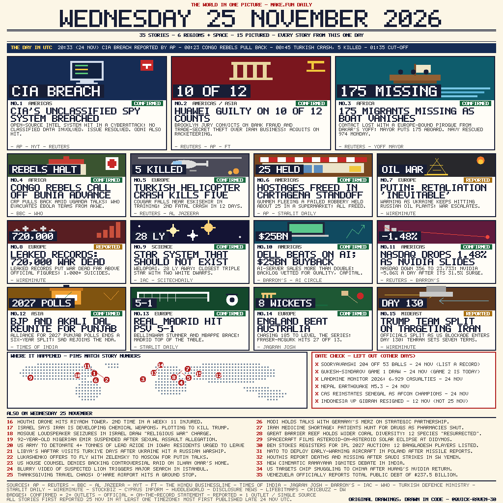

# news-image-20261125 — Wednesday 25 November 2026 in one image

[](https://make.fun/bounty/news-image-20261125)
[](https://make.fun/bounty/news-image-20261125)
[](https://make.fun/bounty/news-image-20261125)

A pure-stdlib Python program that draws a 1024x1024 broadsheet summing up
Wednesday 25 November 2026: 35 stories (3 leads + 12 medium illustrated
with flat pictograms + 20 one-liners), a UTC timeline, a numbered world map,
a DATE CHECK box of stories left out because they belong to other days, and
a sources footer. Original drawings, drawn in code.



## Run

```sh
mkdir -p out && MAKEFUN_OUTPUT_DIR=out python3 main.py
```

Writes `out/entry.png` (1024x1024 PNG, under 1 MiB). Runs twice,
byte-identical: no network, no time, no randomness, standard library only.

## About the day

Stories were first reported on 25 November 2026 in at least one timezone;
most wire stories were first published late 24 Nov UTC, which is early
25 Nov in Asia — the image states that basis in its footer and its
DATE CHECK box names the big stories deliberately excluded (Sooryavanshi's
204, Gukesh–Sindarov Game 1, the Landmine Monitor, the Nepal quake, the
CAS Senegal ruling, and the 12 Nov Gibran resignation).

Sources include AP, Reuters, BBC, Al Jazeera, NYT, FT, The Hindu
BusinessLine, Times of India, Jagran Josh, Barron's, IAC, WHO, the Turkish
Defence Ministry, Starlit Daily, WireMinute and others — see the footer
of the image for the full list.
